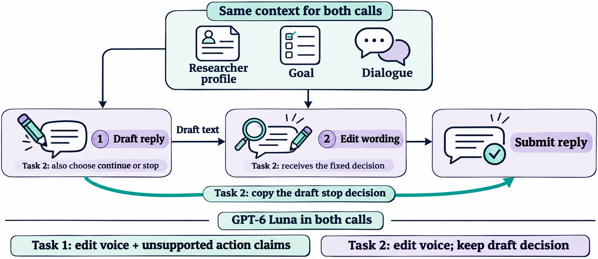

# NP Labs · TREC UserSim 2026

Our submission to the NIST TREC User Simulation Track. We simulated a researcher
looking for datasets with a conversational search assistant supplied by the organizers.

## [Project site →](https://npatta01.github.io/trec-usersim-2026/)

[Notebook paper (PDF)](docs/paper/usersim2026.pdf) ·
[Workshop slides (PDF)](docs/paper/slides/trec-usersim-2026-talk.pdf) ·
[Editable workshop slides](docs/paper/slides/trec-usersim-2026-talk.qmd)

## How we simulated the researcher

GPT-6 Luna drafts and edits each reply using the researcher’s profile,
search goal, and the dialogue so far.

[](https://npatta01.github.io/trec-usersim-2026/#approach)

- **Task 1 predicts one reply.** Each case supplies its own conversation history.
  The editor can correct wording and unsupported claims about completed actions.
- **Task 2 runs the conversation.** The simulator exchanges messages with the
  search assistant. The first model call drafts the reply and decides whether to
  continue. The second call edits the wording.

## Preliminary organizer results

We submitted **62 Task 1 predictions** and processed **57 Task 2 conversations**.
Task 2 had 49 normal endings and eight administrative closures. The scores
below come from the organizers’ November 4 preliminary release.

| Measure | Task 1 | Task 2 |
| --- | ---: | ---: |
| Dialogue-act JSD (lower is closer) | 0.106 | 0.158 |
| Mean human-likeness (0–4) | 2.375 | 2.313 |
| Rated researcher turns | 16 | 67 |

Jensen–Shannon divergence (JSD) compares the mix of dialogue acts, such as
clarification requests, with the human reference. Our replies averaged about 80%
more characters than human replies in Task 1 and 92% more in Task 2. The editor
left 245 of 258 generated Task 2 drafts unchanged.

[Results and analysis](docs/paper/organizer-results-2026-11-07.md)

## Repository guide

- [Illustrated architecture](docs/task2_architecture.md) explains the tasks,
  prompts, and recovery behavior.
- [Submission ledger](docs/submission-ledger.md) records the run IDs, counts, and
  completion audits.
- [Paper evidence map](docs/paper/README.md) links the manuscript, figures, and
  supporting analysis.
- [Simulator code](usersim/) and [runner guides](docs/README.md#run-or-test-the-code)
  cover the runtime and offline checks.
- [Research index](docs/research/README.md) and [project handoff](docs/project-handoff.md)
  document the selected method and project status. Debug v5 remains paused.
- The [documentation index](docs/README.md) links data notes, maintenance
  guides, and project history.

## Local setup

```bash
python -m venv .venv
.venv/bin/pip install -r simulator/requirements-dev.txt
.venv/bin/python -m unittest discover -s tests -p 'test_*.py'
```

The synthetic runtime tests run offline with no keys or participant data. The
[track guidelines](https://trec.usersim.ai/guidelines) and
[organizer starter guide](docs/organizer-starter.md) describe the task contracts.
