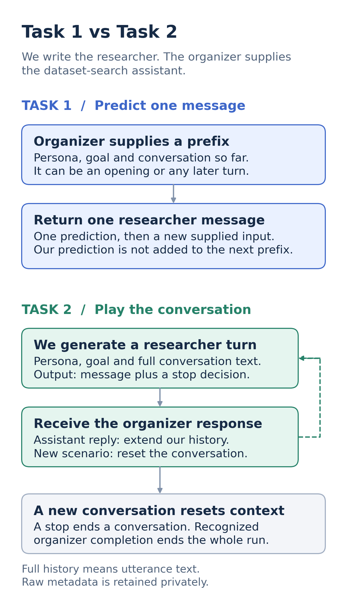

# TREC UserSim 2026

We simulate a researcher looking for datasets. The organizer supplies the
search assistant; our model writes the researcher's next reaction.

**Both official baselines are complete.** Task 1 submitted 62 predictions.
Task 2 processed 57 conversations: 49 normal endings and eight administrative
closures. Completion audits passed; competition results are not yet recorded.
Debug v5 remains intentionally paused.

- [Understand the system](docs/task2_architecture.md): illustrated architecture.
- [Check submissions](docs/submission-ledger.md): run IDs, costs, quotas and evidence.
- [Prepare the paper](docs/paper/README.md): claim-to-evidence map, preserved records and missing items.
- [Start reading or developing](docs/README.md): setup, data, research and history.
- [Resume project context](docs/project-handoff.md): current decisions and limits.
- [Continue without the original chat](docs/continuity.md): durable handoff, private evidence and reader locations.
- [Download preserved artifacts](docs/artifacts.md): GitHub release, checksums and tested restore instructions.

## The two tasks

**Task 1:** given a persona, goal and conversation prefix, predict one researcher
message. Each new input replaces the previous one.

**Task 2:** play that researcher across a conversation, reacting to assistant
replies and deciding when to stop. Reset history on a new conversation.



## The selected baseline

Luna drafts a reply, then makes one editor pass using the persona and observed
researcher voice. Task 1 official uses narrow fidelity editing; Task 2 uses style
editing and retains the draft's stop flag. Available utterance text stays intact.
Compaction and a repeated judge/retry loop are not enabled.

The [method decisions](docs/research/method-decisions.md) explain the alternatives
we tested and the remaining voice, knowledge and persistence concerns. The
[official-data audit](docs/research/official-data-evidence.md) separates training
coverage from assumptions and identifies the missing human-stop supervision.

## Work locally

```bash
python -m venv .venv
.venv/bin/pip install -r simulator/requirements-dev.txt
.venv/bin/python -m unittest discover -s tests -p 'test_*.py'
```

Synthetic runtime tests need no keys, participant data, model calls or organizer
access. See the [runner guides](docs/README.md#run-or-test-the-code) before any
execution. The original starter's two known test-collection failures are
[documented separately](docs/task2_debug_runner.md#setup-and-offline-verification).

| Directory | Responsibility |
|---|---|
| `usersim/` | Supported runtime, prompt builders and checkpoints |
| `scripts/` | Thin runners and documentation rendering |
| `tests/` | Offline synthetic verification |
| `experiments/` | Historical studies and unselected variants |
| `simulator/` | Imported organizer starter |
| `docs/` | Current guides, evidence and preserved history |
| `submissions/` | Public per-run metadata and evidence hashes; exact records are private |

The [original organizer guide](docs/organizer-starter.md) is retained for
provenance. The [official website](https://trec.usersim.ai/) and
[guidelines](https://trec.usersim.ai/guidelines) define the competition.
Training transcripts, model outputs and API receipts are preserved in this repository’s
[evidence release](docs/artifacts.md). Credentials stay outside git and release assets.
