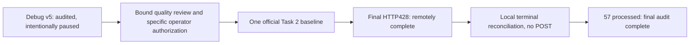
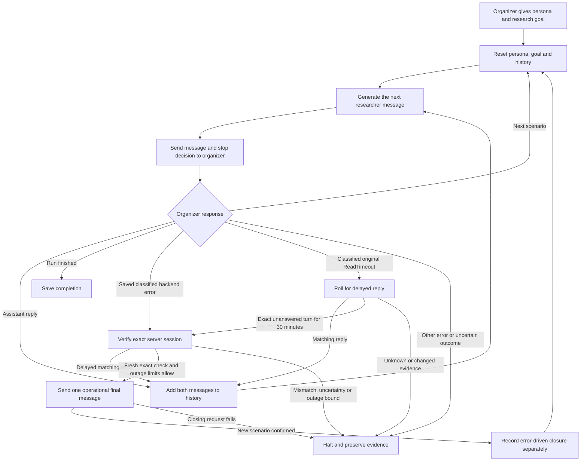
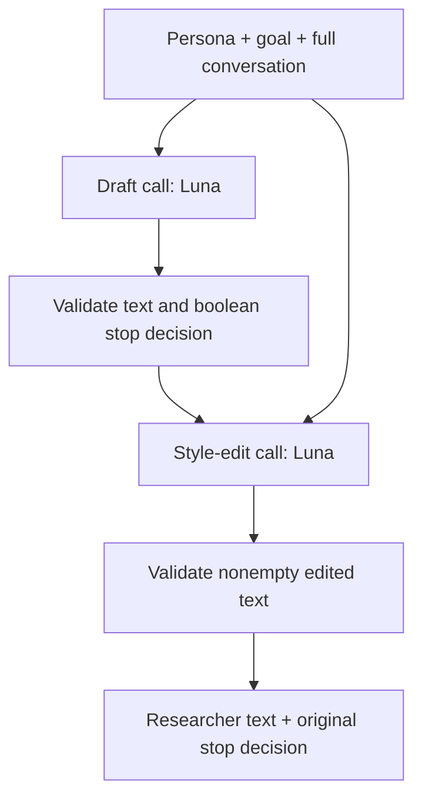
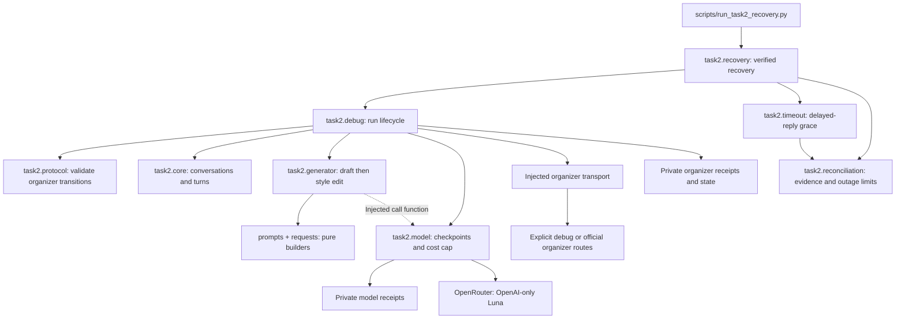

# Historical snapshot: task2_architecture.md

Preserved from public main `0cf46c2` during the October 10 documentation cleanup.
The original dated checkpoints below are historical, including instructions that
were subsequently superseded. Use the [current documentation map](../../README.md)
and [project handoff](../../project-handoff.md) for current instructions.

Source: `docs/task2_architecture.md`. This snapshot preserves the full record; local links were
rebased for its archive location.

---

# Task 2: how our researcher simulator works

## Current status — October 10

Both official baselines are complete. Task 2 processed 57 conversations: 49
normal researcher endings and eight administrative closures. Debug v5 remains
intentionally paused. The [handoff](../../project-handoff.md) and
[submission ledger](../../submission-ledger.md) hold current evidence and limits.



The ordinary official CLI retains its completed-debug gate; the baseline launch
used a separately reviewed private operator exception for this paused prefix.
No further official run is authorized by these diagrams.

We generate the **researcher’s side** of a conversation. The organizer supplies
the dataset-search assistant. These are two separate systems.

## Task 1 versus Task 2

| | Task 1 | This Task 2 runner |
|---|---|---|
| Starting point | A supplied conversation prefix | A new persona and goal |
| Our output | One next researcher message | Repeated researcher messages and a stop decision |
| History | Supplied for each prediction | Built from our messages and organizer replies |
| End of work | That prediction is returned | Organizer says the full run is finished |

## One conversation, from start to finish



Each new scenario supplies a new persona and goal. The history resets completely.
Within a conversation we retain all available utterance text. Persona/goal
fields use the starter representation; raw timestamps, annotations and other
metadata are kept privately but not all rendered. See the
[input projection](../official-data-evidence.md#what-the-model-receives).
We do not compact or summarize history in the current baseline.

An operational close sends `is_final=true` from the researcher to end a
conversation blocked by an observed backend error. It does not erase that
conversation or represent a natural researcher decision. We count these as
skips separately from completed conversations and model-generated stops.

## What happens inside one researcher turn?



The first call produces the next message and decides whether this researcher
would stop: because they have enough help, or because the search is unproductive.
The second call compares the wording with their last two messages and persona.
It may leave the draft unchanged. It preserves the original stop boolean; the
prompt also asks it to preserve the meaning and closure, but code does not prove
semantic preservation. This is not a repeated judge/retry loop.

Chat API roles are mapped from the simulator’s viewpoint:

| Conversation speaker | Model API role | Why |
|---|---|---|
| Instructions, persona and goal | system | Defines whom to simulate |
| Earlier researcher messages | assistant | The model continues this speaker |
| Dataset-search assistant messages | user | These are incoming replies to react to |
| Fixed opening cue, when history is empty | user | Requests the first researcher message |

Opening turns use the supplied scenario without an observed speaking history.
The model does not receive future human messages or reference answers. Each
model request resends the needed context explicitly; there is no hosted
conversation-memory API or automatic compaction behind this diagram.

## Code boundaries

```text
scripts/                 Thin command-line entry points
  run_task2_debug.py
  run_task2_recovery.py   Explicit debug/official mode and recovery policy
usersim/                 Reusable code; no experiment imports
  prompts.py             Persona/history and style-editor prompts
  requests.py            Model payload and response validation
  checkpoints.py         JSON persistence and request hashes
  task2/
    core.py              Conversation and researcher-turn types
    generator.py         Draft and optional style edit
    protocol.py          Organizer response and transition validation
    model.py             Model receipts and spending safeguards
    debug.py             Run lifecycle and injected transports
    recovery.py          Policy, CLI, known HTTP errors and official gate
    reconciliation.py    Shared evidence checks and progress accounting
    timeout.py           Original-timeout polling and durable recovery
experiments/             Historical replays and unselected variants
tests/                   Offline tests and synthetic parity fixtures
simulator/               Original organizer implementation
```



| Responsibility | Module | What it does not decide |
|---|---|---|
| Represent conversations and validate text/stop types | `usersim/task2/core.py` | HTTP behavior or wording |
| Construct model requests and edit one draft | `usersim/task2/generator.py` | Retries, quota, or session transitions |
| Save/reuse model results and reserve spend | `usersim/task2/model.py` | Researcher personality or when to stop |
| Validate incoming history and transitions | `usersim/task2/protocol.py` | Network calls or persistence |
| Advance the run and coordinate transports | `usersim/task2/debug.py` | Whether a recommendation is good |
| Reconcile saved backend failures and close blocked conversations | `usersim/task2/recovery.py` | Whether the researcher naturally wants to stop |
| Wait for delayed replies and reconcile classified original timeouts | `usersim/task2/timeout.py` | Generator wording or recursive closing retries |
| Verify raw evidence and count operational outcomes | `usersim/task2/reconciliation.py` | Network calls or researcher satisfaction |

The runner owns the checkpointed model and injects its call function into the
generator. Prompt construction is pure: it no longer imports experiment runners,
loads LiteLLM, or temporarily replaces a global completion function. Scenario
classes remain shared with the organizer baseline to preserve their exact prompt
representation. Twelve synthetic fixtures preserve pre-refactor requests across
openings, follow-ups, longer histories, missing persona fields, and stop decisions.
The runtime remains sequential; this refactor does not add concurrent execution.

## Why we stop on an uncertain request

```mermaid
sequenceDiagram
    participant R as Our runner
    participant D as Private checkpoints
    participant A as Organizer
    R->>D: Save request before sending
    R->>A: Submit researcher message
    alt Response received
        A-->>R: Reply or HTTP error
        R->>D: Save response receipt
        R->>R: Validate response
        alt Valid reply or transition
            R->>D: Advance conversation state
        else Invalid response or server failure
            R->>D: Preserve evidence and halt
        end
    else Original request raises ReadTimeout
        R->>D: Keep pending request and classify exact ReadTimeout
        R->>A: Read session; wait for delayed reply
        alt Exact original turn remains unanswered for 30 minutes
            R->>A: Fresh session check
            R->>A: One distinct final close, if outage limits allow
            A-->>R: New scenario or explicit completion
            R->>D: Save separate close receipt and operational skip
        else Matching delayed reply
            R->>D: Save GET-derived reconciliation event
        else Unknown, changed evidence or closing uncertainty
            R->>D: Halt without another POST
        end
    else Other uncertain transport outcome
        R->>D: Retain pending request and halt
    end
```

A request can reach the server even when its reply fails. Repeating it could add
the same researcher message twice. We reuse completed local receipts, block
uncertain calls, and never treat HTTP500 or a timeout as successful completion.
This prevents blind retries; it does not guarantee exactly-once delivery or
repair a server-side partial turn.

| Response | Action |
|---|---|
| 200 + valid assistant reply | Append the exchange and generate the next researcher turn |
| 201 or strictly validated 200 + new empty scenario | Record the ending and reset persona, goal, and history |
| 428 + recognized completion message (exact matching ID when run-bound) | Mark the entire run complete |
| Saved 500/502 or exactly classified conversation-bound503 with persisted unanswered turn | Recovery wrapper sends one distinct final message, verifies advancement, and records a skip |
| Classified original ReadTimeout with exact persisted unanswered turn | Wait for a delayed reply; after 30 minutes and a fresh check, allow one distinct close within outage bounds |
| Other errors, mismatched IDs, invalid history, uncertain transport | Halt for inspection |

The default limits ($3 reservation, 500 total researcher turns, 30 per conversation) are
operational safeguards. Hitting one persists `status="halted"` and stops the
whole run without sending an artificial user-stop message. Protocol or transport
errors preserve the last validated progress and private evidence with
`status="halted"`. The recovery wrapper reconciles only the narrow observed
backend-error and classified-original-timeout cases described above. It permits
a default 24 absolute skips, at most 25% of terminal conversations with a denominator floor 8,
and at most 3 consecutive operational skips. A close timeout never enters that
automatic path again.

The recovery CLI exposes a finite positive `--cap-usd` override that is frozen
in the run manifest. On October 9 the user authorized raising v5's reservation
ceiling to $6 after a budget halt; an audited migration preserved its original
checkpoint/source, replayed 775 cached model requests, and retained the current
draft. Passing a larger flag alone cannot bypass an existing frozen budget.
The positive integer `--max-total-turns` override is also frozen, with default
500. After v5 cleanly reached that guard, an audited migration raised only its
total-turn allowance to 1,000, preserving all 962 cached model requests and
saved outcomes. The old configuration/source/state are archived, server history
is checked before migration, and state enablement is last. Per-conversation,
budget and outage bounds remain active; this does not change modeled stopping.

The frozen `--max-operational-skips` selector changes only the absolute recovery
bound. At v5's exact 24-closure pause, a reviewed migration selected 48 while
preserving the 25% and three-consecutive-error circuits, generator and all other
run limits. Old source/policy/state/error are archived; policy is written last.
This permits further administrative recovery, not additional modeled patience.

The backend classifier also recognizes the observed503 only when its structured
agent-unavailable message names the same conversation as the failed request.
Generic503/504 and other unclassified responses halt. The accepted subset is
frozen in policy; GET-derived delayed replies revalidate the original proof.
An audited source/policy migration at650 preserved all generation requests and
limits. The one distinct close returned HTTP200; original request was not resent.

A saved error receipt is replayed locally and fails again without resending. A
pending marker blocks resume even if a receipt also exists: that crash boundary
requires reconciliation. CLI resume still performs read-only authentication and
budget checks. Source/configuration hashes must match the frozen run; this updated
PR cannot directly resume the older live run. Its frozen code and receipts must
remain intact until recovery is explicitly resolved.

## What is demonstrated, and what is still open?

The 139 synthetic runtime tests / 92 subtests cover lifecycle, resets, stop
propagation, budget guards, receipt replay, metadata mismatches, timeout polling,
delayed-reply evidence, outage limits, official-route isolation and terminal
completion/error handling. Full private official replay and remote confirmation
verify 57 processed conversations, saved requests/outputs and separate recovery
accounting. They establish integration and completion, not researcher realism.

The final run-specific HTTP428 was initially rejected. A reviewed local
reconciliation retained the frozen runtime and original failure evidence and
advanced the accepted final message once without another POST. Public source now
shares Task 1's completion classifier and preserves unknown protocol errors;
that fix does not retroactively regenerate official outputs. See the
[completion and recovery record](../task2-recovery-plan.md).

Natural voice, persona differentiation, unsupported knowledge/actions, semantic
editor fidelity and excessive persistence remain concerns. The official training
export has no positive researcher-stop labels. There is no organizer score or
whole-run quality rate yet. The tested [method alternatives](../method-decisions.md)
remain separate from the implemented baseline.

See the [runner guide](../../task2_debug_runner.md) for commands and the
[current handoff](../../project-handoff.md) for status. Earlier debug handoffs preserve
historical failures; they are not instructions to resume completed work.
