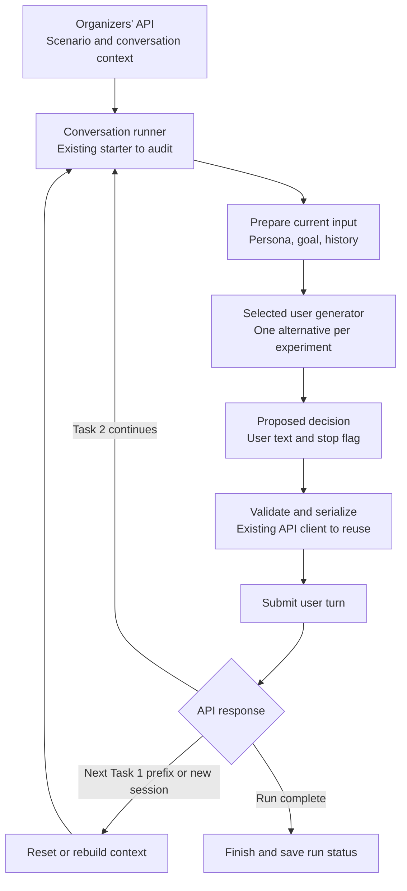
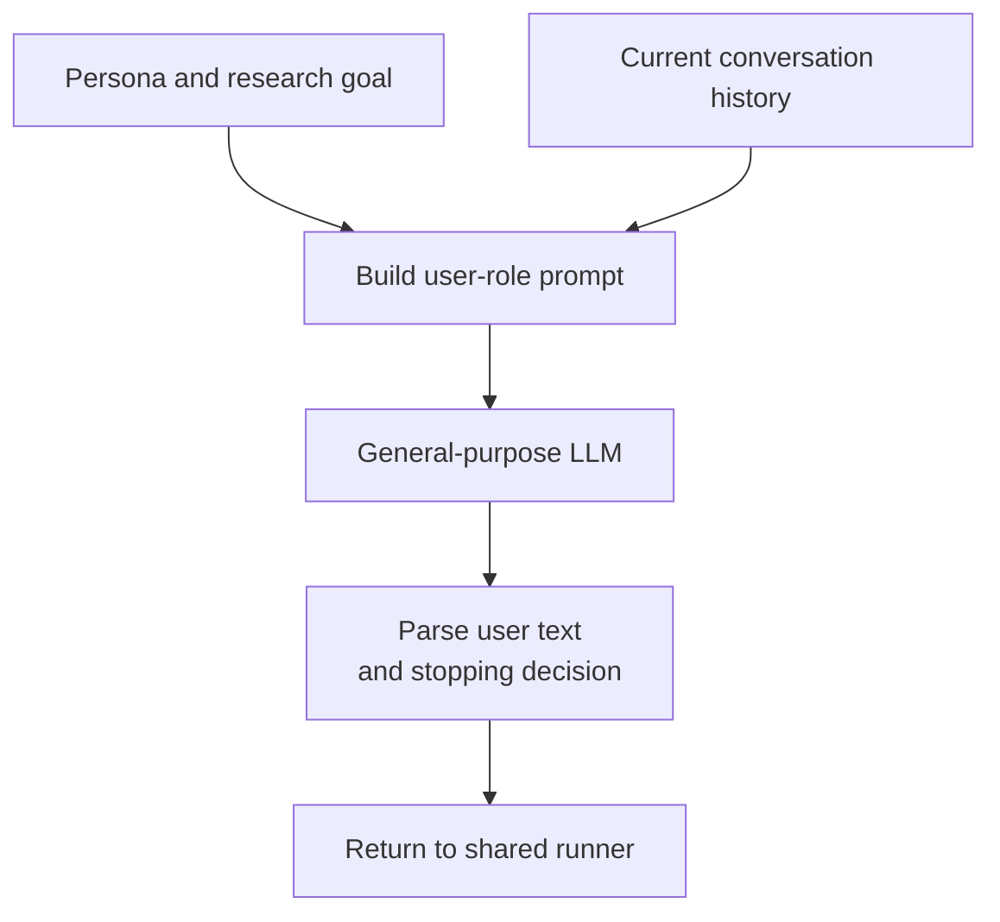
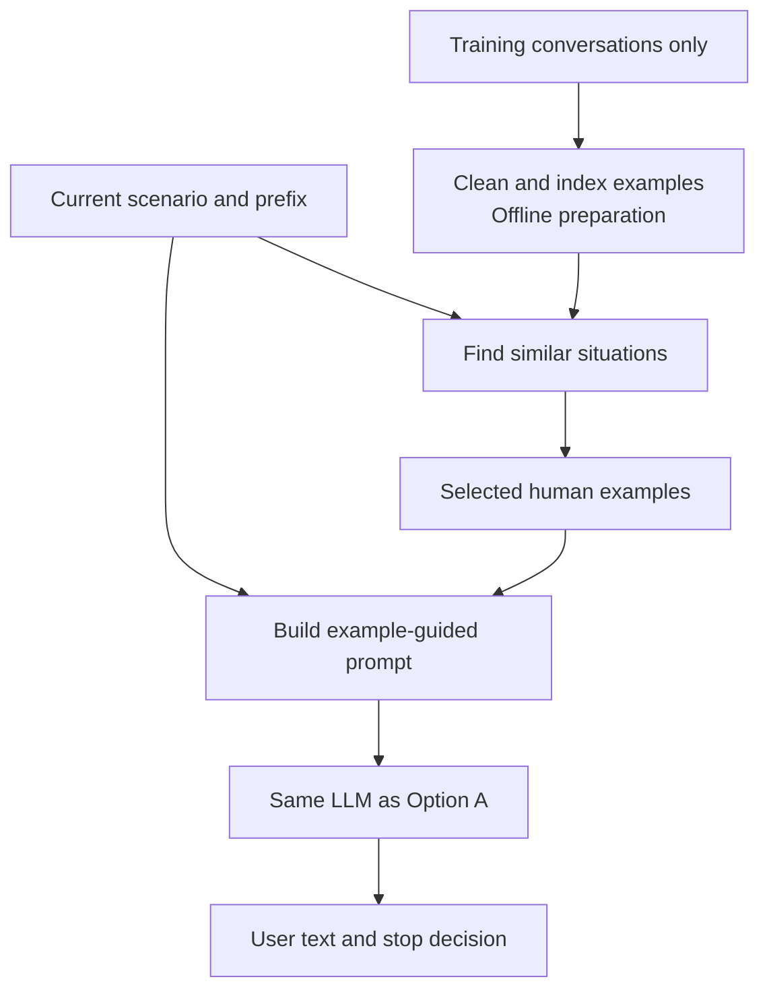
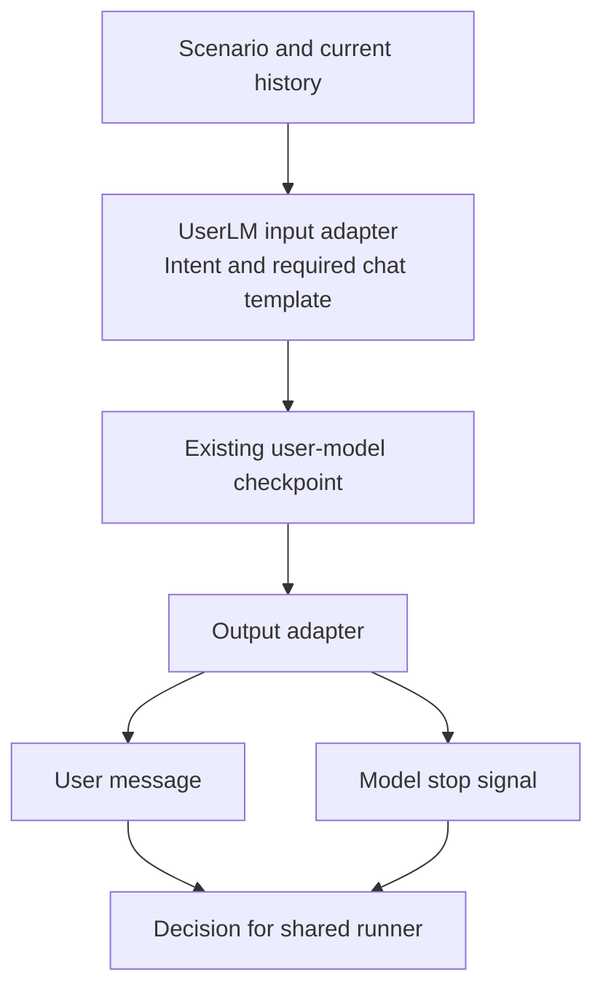
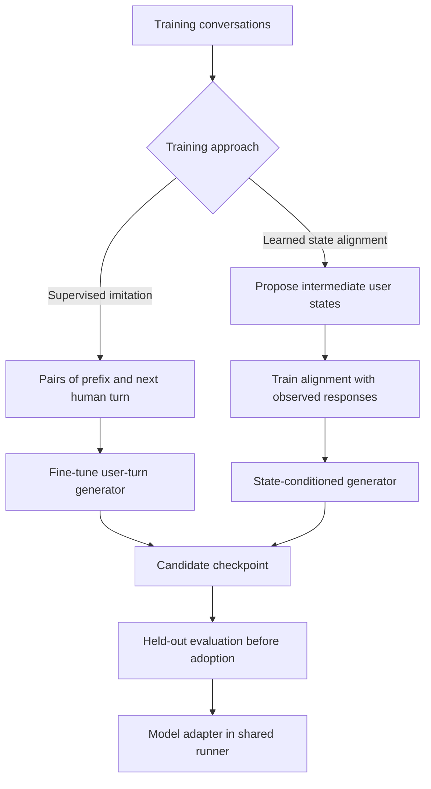
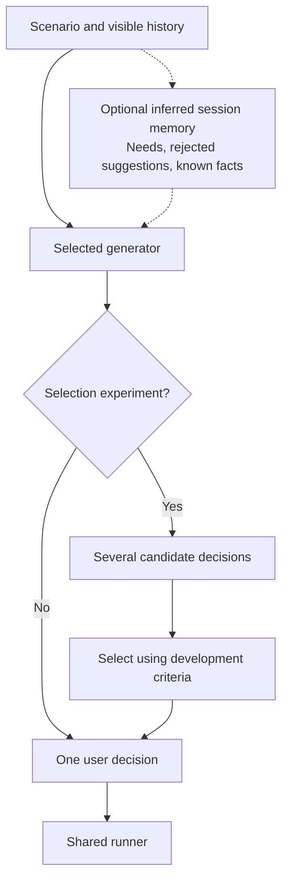
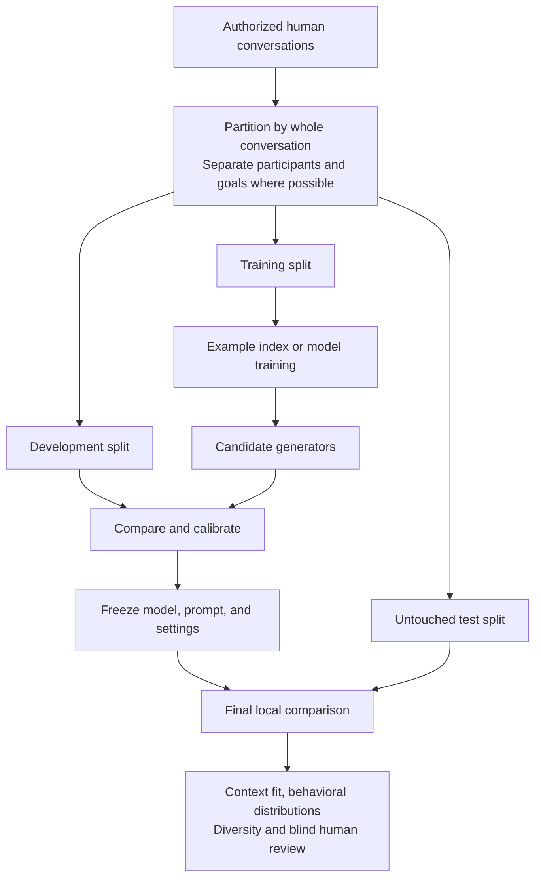

# Current implementation — October 10

See the [implemented architecture](../task2_architecture.md) and
[current handoff](../project-handoff.md). Both official baselines are complete.
Task 1 explicitly selected Luna plus narrow fidelity editing; Task 2 selected
Luna plus style editing and an explicit stop flag. Full available utterance text
is retained. Compaction, planning and retrieval remain unselected.

The [official export has been inspected](official-data-evidence.md): 64
conversations, 10 goals and 266 researcher-message targets, with no positive
researcher-stop labels or verified participant IDs. The supplementary collection
is separate. The [method decisions](method-decisions.md) distinguish tested
variants, rejected approaches and candidates needing more evidence.

# Historical implementation proposals — October 3

These diagrams explain candidate implementations for the approaches in our [research summary](README.md). They are proposals, not a claim that these components exist or outperform one another. Source evidence and limitations are in the [October 3 refresh](2026-10-03-research-refresh.md).

The proposals below were written after the [supplementary inspection](2026-10-03-data-inspection.md), before the official export was supplied. That collection had only 16 participants, malformed turn boundaries, interviewer-imposed endings, and no per-turn state labels; its persona intervention changes the assistant. These diagrams remain conditional proposals, not the implemented runtime. Read the current [official-data assessment](official-data-evidence.md) before considering training, stopping calibration or state control.

The central idea is to reuse one conversation runner and swap the component that generates the human's next message. This makes comparisons easier to interpret. Each diagram includes a text explanation so it remains understandable without Mermaid rendering.

## Shared conversation runner

The organizer sends the scenario and conversation context. Our selected generator produces the user side of the conversation; the organizer supplies the search assistant. The runner must also handle completion signals, new conversations, and resumable runs.

**Task 1:** rebuild from each supplied prefix; previous predictions must not become evidence for the next prediction. **Task 2:** retain only the current session's history and optional memory; reset when the conversation changes. A user stop flag ends a session, not necessarily the entire run. The assistant or platform may also end the session.

**Historical starter interface gap:** the original [ResponseStrategy](../../simulator/src/response_strategies.py) returns only a string. A possible replacement returns a decision such as `UserDecision(text, is_final)`. The existing [continue_conversation](../../simulator/src/user_simulator.py) already accepts `is_final`, but the run loop currently hardcodes it to false. The diagrams below propose alternatives. The implemented `usersim/task2/` runtime now returns validated text/stop decisions; it does not change the original starter interface. Generation failures must follow an error/retry path rather than become simulated human messages.

## Option A — Direct prompting

Everything needed for a turn goes into a prompt. The model writes the human's message. A stopping policy could be integrated with structured generation or handled separately; either way, all Task 2 variants need one.

**Smallest change:** develop the existing `LLMStrategy` after auditing history construction and scenario handling. No model training is needed. This is the reference system against which additional components should earn their complexity.

## Option B — Human-example retrieval

Find real examples of comparable conversational situations, then add them to the prompt. The retrieval index contains only the training split. The current input creates the query; the hidden target reply must never influence retrieval.

**Example:** after an assistant violates a requirement, retrieve cases where humans rejected unsuitable recommendations. Compare no examples, random examples, topic-based retrieval, and situation-based retrieval at comparable context budgets. Retrieved conversations demonstrate behavior; their dataset facts and personas should not be copied into the current user's identity.

## Option C — Existing user model

Use a model already trained to generate human turns. The adapter translates our scenario and history into that model's expected format and translates its completion signal back into our decision format.

The official UserLM model card documents an end-of-conversation token. Persona fidelity is still something to measure: adding scenario fields does not establish that the checkpoint learned to respect them. Existing-model inference requires no new training, but it does require a compatible runtime and an integration check.

## Later options — Training our own generator

Both paths below start with authorized training data. Validation and test conversations stay separate. “State” means an inferred description of the person's beliefs or reactions, not directly observed cognition.

This is a conceptual distinction, not a reproduction recipe for HumanLM. Simple supervised fine-tuning teaches next-turn prediction directly; learned state alignment adds a training objective for intermediate representations. Neither is justified by our current data inventory alone. Training may use observed target responses; inference must use only the available prefix and scenario.

## Optional memory and candidate selection

These are separate experiments, not mandatory layers in every option. Keep a full-history-only control when testing a state summary. If selecting among replies, evaluate with a judge independent of the selector.

A consistent session style can condition any generator. A mixture chooses a generator or style once per session to study variation across people. These additions can create stereotypes, compound state errors, or reduce diversity, so they should be retained only after comparisons.

## Evaluation without future-turn leakage

Partition before building the retrieval index or training a generator. Use development data for choices and calibration. Preserve an untouched test set for the final local comparison, with whole conversations and participant/goal separation where possible.

All candidates see identical Task 1 prefixes. Task 2 needs a separate end-to-end comparison with stopping and session resets. A plausible single message does not establish realistic full conversations. None of these diagrams implies permission to submit official runs or send participant data to a model provider.

## Mapping the proposal onto this repository

| Component | Existing starting point | Proposed responsibility |
| --- | --- | --- |
| Scenario input | [scenario.py](../../simulator/src/scenario.py) | Preserve persona, goal, and their interaction. |
| Conversation runner | [user_simulator.py](../../simulator/src/user_simulator.py) | Correct prefix/session handling, reset, resume, and propagate stopping. |
| Generator interface | [response_strategies.py](../../simulator/src/response_strategies.py) | Swap direct prompt, retrieval, or user-model adapters behind one decision interface. |
| API serialization | [api_client.py](../../simulator/src/api_client.py) | Reuse organizer protocol and validate outputs. |
| Data preparation and evaluation | Not implemented in this proposal | Reproducible splits, training-only indexes, comparison reports, and provenance. |

The first implementation milestone would be one correctly wired direct-prompt generator through the shared runner, followed by offline comparisons. The [research summary](README.md) remains the canonical place for decisions and next actions.
