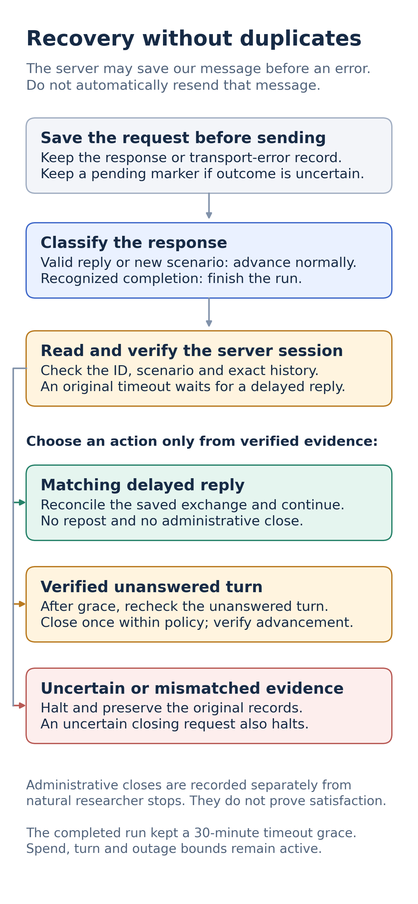

# Task 2 recovery guide

Both official baselines are complete; debug v5 is intentionally paused.
This guide explains supported recovery boundaries, not a request to resume them.
Use the [current handoff](../project-handoff.md) and [submission ledger](../submission-ledger.md)
for status, frozen source and private evidence locations.

## Why an error does not justify resending

The organizer may save a researcher message before assistant generation fails.
Reposting that message could duplicate it. Keep the exact request, response or
transport-error proof, pending marker and checkpoint. Do not clear uncertainty
by fabricating a receipt or treating HTTP500/timeout as completion.

## Supported recovery paths

| Evidence | Action |
|---|---|
| Saved HTTP500/502, exact persisted unanswered turn | Read and verify the session; recover a delayed reply or permit one distinct administrative close within limits |
| Observed503 with structured agent-unavailable message naming the failed conversation | Same checks and guards; generic503/504 are not recoverable by this classifier |
| Durable classification of the original ReadTimeout | Poll read-only session every 30 seconds; first exact unanswered observation starts the 1,800-second grace |
| Matching delayed reply | Reconcile from GET evidence; no original POST receipt is invented and no close is sent |
| Exact unanswered turn after timeout grace | Recheck session and policy, then allow one distinct close; verify new scenario or recognized completion |
| Unknown shape, mismatched IDs/history, uncertain closing request | Halt and preserve evidence; no recursive close/retry |

Raw scenario, conversation ID and exact history must agree; matching text alone
is insufficient. A pending marker can block automatic resume even when a receipt
also exists. A saved error is replayed locally, not resent.

## Limits and frozen policy

Default safeguards are $3 cumulative model reservations, 500 total turns,
30 turns per conversation, 24 administrative closures, at most 25% of terminal
conversations with denominator floor 8, and three consecutive closures.
The actual official run selected $6 reservations and 1,000 turns, while keeping
30 per conversation and default outage limits. Reservations are not dollars spent.

Changing source, absolute source paths, configuration or recovery policy blocks
ordinary resume. A deliberate migration archives original bytes, replays requests
and outcomes, verifies fresh server history, binds new proof/source hashes and
enables state last. A larger CLI flag alone cannot amend an existing manifest.
Never reuse a historical run ID in a new empty directory.

The ordinary official CLI requires completed, reviewed debug evidence. The
submitted baseline used a separately reviewed private operator exception bound
to the user's audited paused-prefix decision; it is not a general gate bypass.
See the [execution guide](../task2_debug_runner.md) for supported flags and credential
locations. These paths are not an exactly-once delivery guarantee or a server
rollback mechanism.

## October 10 completion reconciliation

The official final HTTP428 named the exact run and said it was finished. Our
Task 2 parser rejected that longer wording, then recovery masked the protocol
error. Fresh organizer status/summary confirmed 57 processed and zero remaining.

A reviewed local procedure archived the old state/error, verified the run-bound
receipt and fresh GET evidence, reproduced all cached model requests/submissions,
preserved the frozen runtime and advanced the accepted final turn once.
No POST, model request or new allowance was used. Public source now shares Task
1's completion classifier and preserves unclassified protocol errors. Historical
worker/watcher failed exits remain as evidence; reconciled state/audit are complete.

The final audit separates 49 normal stops from eight administrative closures
(five backend, three timeout), plus three delayed replies recovered without a
close. Key private evidence is `integrity-audit.json`, `final-status.json`,
`final-summary.json`, `final-budget.json`, `terminal-reconciliation/` and the
source-pinned `completion-audit-tools/`. See [artifact locations](../submission-ledger.md#private-artifact-locations).

## Evidence and future changes

Runtime checks cover response shapes, exact history, delayed replies, outage
limits, frozen policies, pending boundaries and run-bound completion. Private
request/receipt replay verifies submission integrity, not human realism.

The [full recovery chronology](archive/2026-10-10-recovery-history.md) retains
all review, migration, timeout and reconciliation records. A shorter grace was
proposed after timing inspection, but was not applied. The completed run kept
1,800 seconds; no universal sufficient waiting limit has been established.
