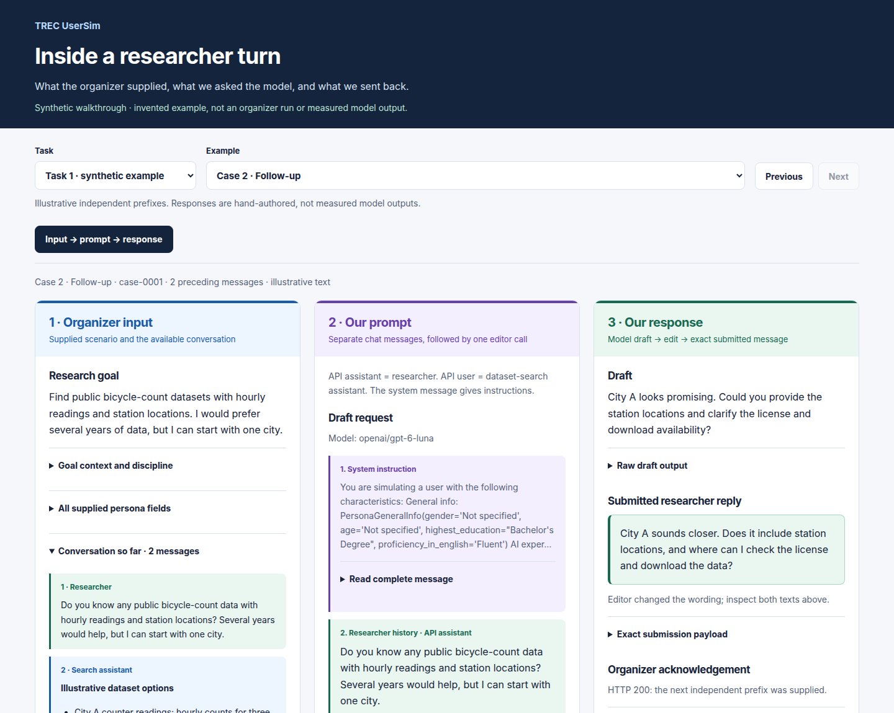
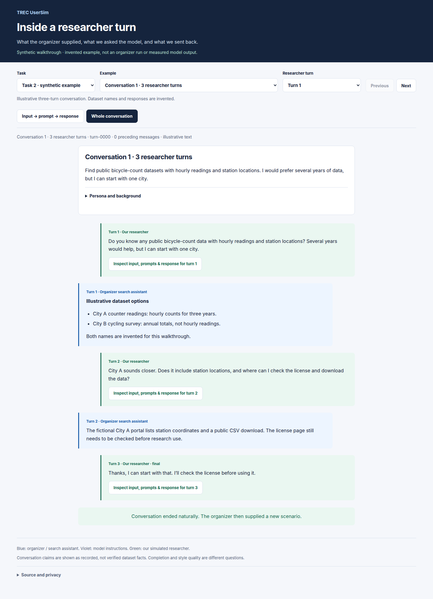

# Read input, prompts and responses

The viewer makes one researcher turn inspectable: **organizer input → draft and
editor prompts → submitted response**. A second view shows a complete Task 2
conversation, with a button on each researcher message to inspect that turn.

## View the saved official examples privately

- [Task 1: input, prompts and response](https://npatta01-framework.tail481212.ts.net/plans/trec-usersim-run-viewer/?task=1&case=case-0001&turn=1&view=turn).
- [Task 2: one complete six-turn conversation](https://npatta01-framework.tail481212.ts.net/plans/trec-usersim-run-viewer/?task=2&case=conversation-07&turn=1&view=conversation).

These links use the existing private tailnet portal. They contain 62 saved Task 1
official cases and one ordinary Task 2 conversation, selected from the completed
run. The reading copy makes no model or organizer calls. The older 64-case Task 1
debug viewer remains a separate historical artifact.

Blue identifies organizer input / the search assistant; violet identifies model
instructions; green identifies our simulated researcher. Labels carry the same
meaning without color. Expand persona fields, complete messages, the editor
request, or exact JSON. No full message is discarded for display. Markdown bold,
lists and code are rendered; embedded HTML and executable content remain text.

For Task 1, predictions are independent prefixes; the viewer does not stitch them
into a fabricated generated conversation. For Task 2, the endpoint sends a new
scenario or latest utterance, while our runner retains the history. Both the raw
organizer input and the assembled context are available. The final new scenario
is excluded from the finished thread. A natural stop is distinct from an error
closure; this example contains no administrative closure.

## Public illustration

The repo includes a [self-contained HTML walkthrough](examples/run-viewer.html)
and its [synthetic fixture](../tools/run_viewer/demo.json). Download the HTML and
open it in a browser; GitHub's file viewer does not execute it. A
[private portal copy](https://npatta01-framework.tail481212.ts.net/plans/trec-usersim-demo/?task=1&case=case-0001)
is also available.

The screenshots below are **entirely invented examples**, not official transcript
snippets or measured model outputs. Their request messages were constructed
offline with the current prompt builders on October 10. The replies and dataset
names are hand-authored to explain the interface; no realism gain is claimed.



<details>
<summary>See the invented full conversation</summary>



</details>

## Rebuild the reading copies

From the repository root, using standard-library Python:

```bash
python scripts/render_run_viewer.py --demo --output docs/examples/run-viewer.html

# Read only saved receipts; no keys or inference required.
python scripts/render_run_viewer.py \
  --task1-dir /path/to/private/task1-run \
  --task2-dir /path/to/private/task2-run \
  --task2-conversation 7 \
  --output /path/outside/repository/reading-copy.html
```

The exporter supports the completed runs' receipt layout, not every historical
runner layout. Task 2 selection is 1-based among conversation IDs in saved
continuation receipts. It requires a fresh scenario input, uninterrupted
successful receipts and matching model history within the selected conversation,
then a natural final stop and new-scenario transition. Missing or administratively
closed examples refuse export; the renderer does not invent a reply or recover a
run. Task 1 checks saved draft/editor output against the case and submission.

Private reading copies cannot be written inside the checkout. The exporter
rejects unknown model-request fields, authentication-like fields and known
credential patterns. It projects text, model requests, selected usage, submission
and acknowledgement bodies; it excludes raw response envelopes, manifests,
authentication headers and unrelated artifacts. This is a focused check, not a
general anonymizer. Keep actual reading copies private; never commit them.

Source is split into [export.py](../tools/run_viewer/export.py),
[HTML](../tools/run_viewer/viewer.html), [CSS](../tools/run_viewer/viewer.css) and
[JavaScript](../tools/run_viewer/viewer.js), with the thin CLI above. All assets
are bundled into the output. There are no external fonts, libraries, automatic
link fetches, model calls or organizer calls. A content-security policy blocks
external resource loads and requests.

## Verification and status

October 10: all 62 displayed Task 1 outputs matched saved model and organizer
receipts. The six-turn Task 2 example has 0/2/4/6/8/10 preceding messages, five
continue decisions and a final natural stop; each reconstructed history matched
its recorded model request. Credential refusal, script escaping and byte-identical
regeneration passed.

Browser QA used installed Playwright and Chrome after the in-app browser reported
`Browser is not available: iab`. Desktop (1440 pixels), phone (390 pixels) and
dark appearance passed. Task/example/turn selection, prompt expansion,
conversation-to-turn navigation and URL restoration were exercised; no page or
console errors, automatic external requests or horizontal overflow were found.
The actual live HTTPS copies and portal index links were checked separately.

Current status: reading copies verified. No new inference or organizer requests.
Next: review the examples; the [submission ledger](submission-ledger.md) owns
coverage and costs, and this viewer does not assign a quality or competition score.
