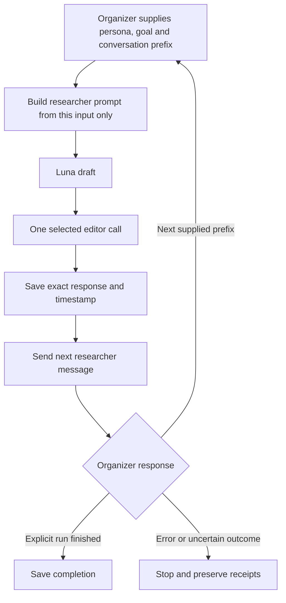

# Task 1 runner

`usersim/task1.py` runs one next-utterance evaluation with the shared Luna prompt
and default-on style editor. Every organizer-supplied prefix replaces the prior
input completely. Unlike Task 2, it never appends its own predictions to the next
supplied history. A supplied history may also end with the researcher: every turn is preserved,
and a conditional instruction requests a researcher continuation without
inventing an intervening search-assistant reply. Empty and assistant-ending
requests retain their existing format.

The editor receives the same persona/goal/history and the last
two researcher messages. It can leave a draft unchanged; an invalid edit stops
execution rather than silently substituting the draft.



Both modes use this same loop. Debug writes only to `/task1/debug/*`; official
writes only to `/task1/run/*`. Switching mode requires a new authorized run,
never changing the mode of an existing checkpoint directory.

## Preview and modes

The default mode is debug. Preview loads no credentials, creates no output
directory, and makes no network calls:

```bash
.venv/bin/python scripts/run_task1.py --mode debug \
  --run-id YOUR_UNIQUE_DEBUG_RUN_ID --output-dir /YOUR/PRIVATE/RUN/DIRECTORY
```

Adding `--run` executes that selected mode. Official submission requires explicit
`--mode official --run` and submission authorization. Debug and official use the
same generation path; only their organizer routes differ. `--no-style-postedit`
is an explicit opt-out, not the selected default.

`--editor-policy fidelity` selects the tested narrow editor: the same voice pass,
plus local repair of unsupported performed-action claims. It preserves optional
preferences and reasonable compromises. The compatibility default is `style`;
new runs selecting the repair must pass `--editor-policy fidelity` explicitly.
Combining fidelity with `--no-style-postedit` is rejected, rather than silently
skipping the chosen editor. The policy is frozen in the manifest; changing it
requires a new run directory and run ID, never resuming a historical run with a
new policy. See the [comparison and limits](research/task1-fidelity-fix.md).

Private credentials remain in `~/.config/trec-usersim/organizer.key` and
`~/.config/trec-usersim/openrouter.key`. Check team identity and the relevant quota
before a new run. A start consumes that mode's allowance; completion is only
recognized from explicit organizer finish messages.

## Safety and evidence

Each run is process-locked, freezes its mode/configuration and source snapshots,
and stores exact requests, model responses, draft/edited text, organizer receipts,
and timestamps. The model reservation ceiling is $1 per run, with OpenAI-only
routing and frozen per-token price limits. Invalid costs, output failures, unknown
completion responses, and uncertain transport halt execution. Cached receipts are
replayed locally; pending markers block automatic resume. Never reuse a run ID
in a new empty directory to recover a previous run.

No private participant text or run output belongs in git. Changed source/config
blocks resumption. File replacement is used for checkpointing; parent-directory
power-loss durability is not established.

## Verification

The current suite has 87 offline tests. Task 1 coverage includes debug/official
route isolation, default editor, independent prefix replacement, replay without
reposting, uncertainty, cost caps and source/config changes. A separate local
replay of all 64 saved debug cases preserved every draft request and editor input;
its editor was an identity stub, so that replay tests wiring rather than quality.

See [live validation and submission status](research/task1-live-validation.md).
