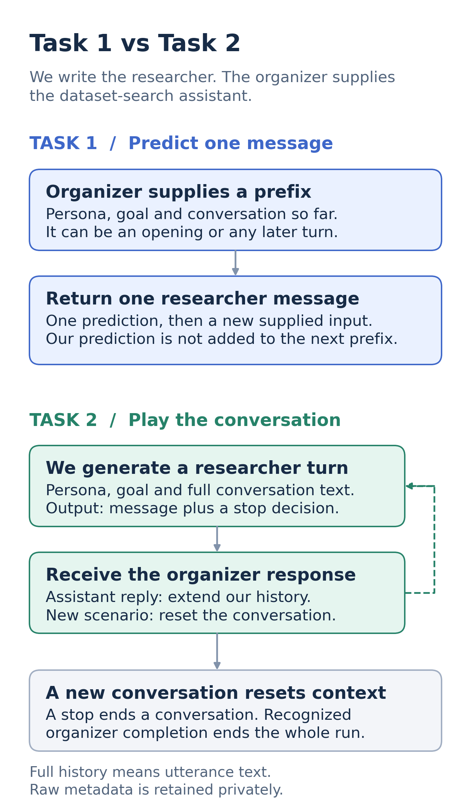
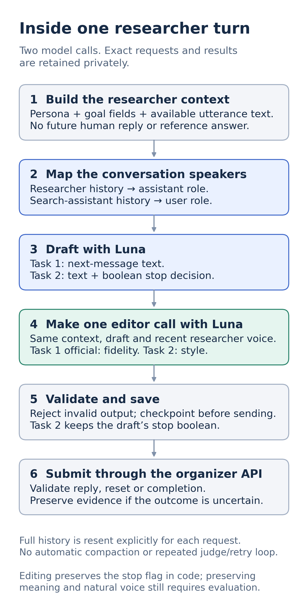
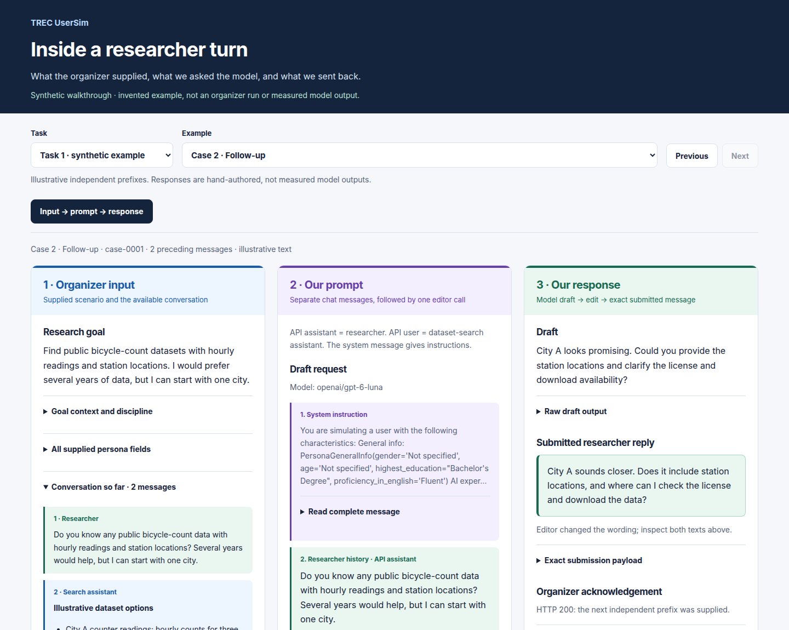
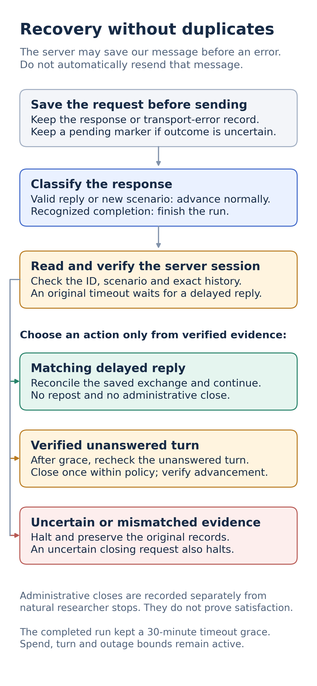

# How the researcher simulator works

We generate the **researcher's side**. The organizer supplies the dataset-search
assistant. Both official baselines are complete; [submission accounting](submission-ledger.md)
is separate from simulator quality.

## Task 1 versus Task 2

Task 1 can predict an opening or any later turn. It rebuilds context for every
supplied prefix; previous predictions never leak into the next case. Task 2
retains the current conversation and resets persona, goal and history on a
validated new conversation. Ending one conversation does not finish the whole run.

## What happens inside one researcher turn?

The editor receives the original context, draft and last two researcher messages.
It can leave the draft unchanged. Task 1 official explicitly selects the narrow
`fidelity` editor, which can repair an unsupported claim of a performed action;
the CLI compatibility default remains `style`. Task 2 keeps `style` and returns
strict text/stop output. Code preserves its draft stop boolean; semantic meaning
preservation is an instruction, not a code guarantee.

## See the input, prompt and response

The [rendered reader](run_viewer.md) shows all saved Task 1 official cases and
one complete Task 2 conversation on the private portal. Each researcher turn
opens its supplied input, exact draft/editor messages and submitted text.

This public screenshot uses an **invented example**, with no participant data
or measured model outputs:

## Why the chat roles look reversed

| Material | Model API role |
|---|---|
| Instructions and persona/goal context | `system` |
| Researcher's previous utterances | `assistant` |
| Dataset-search assistant's replies | `user` |

The model generates an `assistant` message, so that API role represents the
researcher. It is independent of the search assistant's name in the dataset.
Opening and researcher-ending prefixes have explicit continuation instructions.

The baseline renders persona groups, goal context/topic/discipline, familiarity,
known datasets and **all available utterance text**. Other raw metadata is saved
privately but not all rendered. See the exact [input projection](research/official-data-evidence.md#what-the-model-receives).

Requests use `openai/gpt-6-luna` through OpenRouter, OpenAI-only with no fallback.
They resend context explicitly; there is no hosted conversation-memory API,
automatic compaction, retrieval or repeated judge/retry loop enabled.

## Why we stop on an uncertain request

A server may save our message before returning an error. Blind retry could
submit it twice. The runner checkpoints requests and receipts, verifies the
server's exact session, and recovers only narrowly classified evidence.

See the recovery image and the rules

- A matching delayed reply continues without another POST.
- A verified unanswered turn can receive one distinct administrative close,
  after applicable grace, a fresh session check and outage checks.
- Unknown or mismatched evidence, and an uncertain closing request, halt.
- Administrative closures are recorded separately from natural researcher stops.
- Recognized HTTP428 completion finishes the run; a run-bound message must name
  the exact run ID. HTTP500 or a timeout is not completion.

The completed run kept a 30-minute original-timeout grace. Other default guards
are $3 reservations, 500 total turns, 30 turns per conversation, 24 closures,
25% of terminal conversations (denominator floor 8), and three consecutive
closures. A frozen override requires an audited migration. See the
[recovery guide](research/task2-recovery-plan.md) for exact boundaries and evidence.

## Code boundaries

| Responsibility | Source |
|---|---|
| Context and editor instructions | [prompts.py](../usersim/prompts.py) |
| Provider request and text validation | [requests.py](../usersim/requests.py) |
| Task 1 independent-prefix loop | [task1.py](../usersim/task1.py) |
| Task 2 draft and editor | [generator.py](../usersim/task2/generator.py) |
| Immutable conversation/turn types | [core.py](../usersim/task2/core.py) |
| Organizer response validation and completion | [protocol.py](../usersim/task2/protocol.py) |
| Cached model calls and spend reservations | [model.py](../usersim/task2/model.py) |
| Run lifecycle and organizer receipts | [debug.py](../usersim/task2/debug.py) |
| Recovery, exact evidence and timeout waiting | [recovery.py](../usersim/task2/recovery.py), [reconciliation.py](../usersim/task2/reconciliation.py), [timeout.py](../usersim/task2/timeout.py) |

Runtime code does not import historical experiments. The runner injects a cached
model-call function into the generator and executes sequentially. Source/config
hashes and locks guard replay and resume; uncertain pending calls block it.

## What is demonstrated, and what is still open?

Synthetic runtime checks and private request/receipt replay establish integration
and submission integrity. Task 2 processed 57 conversations: 49 normal endings
and eight administrative closures. Completion initially needed a reviewed local
terminal reconciliation, with no repeated POST or regenerated output.

Voice, persona differentiation, unsupported knowledge/actions and excessive
persistence remain concerns. The training export has no positive researcher-stop
labels, and no competition score or whole-run realism rate is recorded. See
[method decisions](research/method-decisions.md) and the [current handoff](project-handoff.md).

The [previous architecture snapshot](research/archive/2026-10-10-architecture-history.md)
preserves detailed Mermaid diagrams, refactor checks and individual migrations.
Image sources and regeneration are in [maintenance](maintenance.md).
