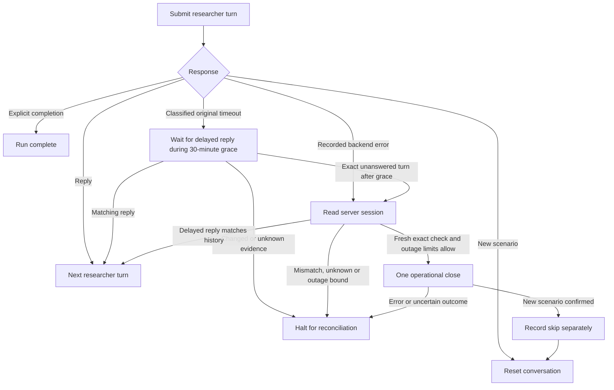

# Checkpointed Task 2 debug runner

## Current operator decision — October 9

v5 is intentionally paused with an audited prefix:886 turns, 129 normal endings,
38 server-error closures and one unfinished conversation. No request is pending.
No HTTP428/debug-completion claim is made. The ordinary official CLI keeps its
completed-debug gate. For the user's decision to stop debug and send a baseline,
a separate private launcher binds the paused evidence and quality review before
credentials/POSTs, retaining the tested runtime and official default 24 outage
limit. See [readiness and limitations](research/task2-recovery-plan.md).


The runner simulates the researcher through complete organizer conversations.
It sends the supplied persona, goal, and full available history to GPT-6 Luna,
then applies one style edit that preserves the generated boolean stop decision.
This integration does not change the selected prompts or enable compaction.

See the [illustrated architecture](task2_architecture.md) for the complete loop,
model calls, code boundaries, and recovery behavior.

## Setup and offline verification

From the repository root:

```bash
python -m venv .venv
.venv/bin/pip install -r simulator/requirements-dev.txt
.venv/bin/python -m unittest discover -s tests -p 'test_*.py'
.venv/bin/python -m pytest simulator/tests
```

Verification for this PR: all 135 included runtime tests and 86 subtests pass.
The 39 focused budget/model/recovery tests and 19 subtests also pass under optimized Python.
The selected-policy CLI and gate checks pass 9 tests / 15 subtests under optimized Python.
The unchanged legacy simulator suite
cannot collect two modules because they import the removed `PersonaDefinition`;
the same error reproduces on the remote base (`45de4e1`).

The new tests use synthetic inputs and injected transports; they do not require
credentials, the official dataset, paid inference, or organizer access.
Historical replay modules live under `experiments/` and are not imported by the
runtime. They require private local artifacts and are not part of the debug
invocation below. See [code layout](../experiments/README.md) for provenance.

## Modules

- `usersim/prompts.py`, `requests.py`, `checkpoints.py`: shared pure builders and persistence.
- `usersim/task2/core.py`: immutable conversation state and strict text/stop parsing.
- `usersim/task2/generator.py`: draft and default-on style editor.
- `usersim/task2/protocol.py`: organizer history and transition validation.
- `usersim/task2/model.py`: cached model calls and cost reservations.
- `usersim/task2/debug.py`: run lock, source/config snapshot, scenario lifecycle,
  injected transports, and recovery guards.
- `usersim/task2/recovery.py`, `reconciliation.py`, `timeout.py`: explicit policy,
  evidence accounting and bounded original-timeout reconciliation.
- `scripts/run_task2_debug.py`: thin CLI wrapper; `tests/` contains offline tests.

The default runner permits only `/task2/debug/start` and `/task2/debug/continue`.
HTTP200 consumes a verified incremental assistant reply, full history, or a
strictly validated new empty scenario; HTTP201 starts a new empty scenario.
HTTP428 is completion only with explicit completion text. HTTP500 and timeouts
stop the default runner. The explicit recovery wrapper below can reconcile
observed HTTP500/502 failures, exactly classified conversation-bound503
agent-unavailable responses and durably classified original ReadTimeouts;
unknown outcomes and uncertain closing requests still halt.

## Authenticated execution

This is a paid model/API operation and requires a separately authorized debug
run. Store credentials outside the checkout in owner-readable files:
`~/.config/trec-usersim/organizer.key` and `~/.config/trec-usersim/openrouter.key`.
The configured team is NP Labs; model routing is OpenAI-only with no fallback.

```bash
.venv/bin/python scripts/run_task2_debug.py --run \
  --run-id YOUR_AUTHORIZED_UNIQUE_RUN_ID \
  --output-dir data/official/YOUR_PRIVATE_RUN_DIRECTORY
```

Each new run consumes one debug allowance. The default reservation ceiling is
$3; operational bounds are 500 total researcher turns and 30 per conversation.
A bound halts execution; it does not invent a voluntary user stop.
All private outputs under `data/official/` are ignored by git.

## Resume and the current halted run

Do not invoke the historical default run ID from a clean checkout: its local
receipts are not in git. Use the original private run directory for recovery.
Completed receipts are reused, while an in-flight marker blocks automatic retry.
A changed source/configuration also blocks resume. The manifest currently records
absolute source paths, so moving the checkout is not a supported automatic resume.
This PR changes the frozen source and cannot directly resume the older live run.
A saved server failure is not
silently retried. Preserve timestamped requests and receipts before reconciliation.

The first live attempt accepted four researcher messages but failed generating
the fourth assistant reply. No full conversation completed. Reposting could
create a duplicate user turn. See the [handoff](research/task2-debug-handoff.md)
and [unsent support request](research/task2-debug-recovery-request.md).

The PR contains source, synthetic tests, and aggregate findings only. Official
training transcripts, model outputs, credentials, and private API receipts are
not included. Completing a debug conversation will still not establish human
realism or official evaluation performance.

## Verified backend-error closure

The opt-in `scripts/run_task2_recovery.py --run --mode debug --run-id ID
--output-dir DIR` reconciles saved 500/502 or narrowly classified503 responses with GET session.
A persisted unanswered turn may be followed by one operational final message,
then advancement must be confirmed. This is counted as a skip, not researcher
satisfaction. Delayed replies are reconciled without reposting. Unknown outcomes
and failed closing requests halt. A classified original ReadTimeout preserves
its pending request, polls GET session every 30 seconds, and starts a 30-minute
grace at the first exact observation of its persisted unanswered turn. Another
fresh check precedes any operational close. This does not apply to a timeout
on a closing request. Policy v2 freezes max 24 skips, max 25% with a denominator
floor 8, and max 3 consecutive skips, alongside existing spend/turn limits.
The recovery policy is frozen separately. See the
[canonical recovery plan](research/task2-recovery-plan.md) for migration evidence.
The recovery CLI accepts `--cap-usd AMOUNT` for an explicitly authorized total
reservation ceiling; its default remains $3. Invalid amounts are rejected before
credential access. Changing a frozen run still requires an audited checkpoint
migration; passing a higher flag alone cannot bypass its manifest.
The recovery CLI also accepts `--max-total-turns COUNT`, a positive integer
validated before credentials. The default remains 500. A frozen run rejects a
different count; changing it requires an explicitly audited migration while the
service is stopped. Archive the old manifest, source and state, replay saved
requests and outcomes, verify the current server history, and enable the
checkpoint last. This changes an operational guard, not the researcher's stop
decision. Per-conversation, spend and outage limits continue to apply.
`--max-operational-skips COUNT` selects the absolute backend-error closure
guard, with default 24 and positive-integer validation before credentials.
The selected value is frozen in `recovery-policy.json` and used by both saved
HTTP500/502 and original-timeout recovery. Fraction (25%, denominator floor 8)
and consecutive-error (3) circuits stay fixed. A different CLI value alone
cannot change an existing policy. A reviewed migration must preserve the
original failed request, archive source/configuration/state/error evidence,
freeze the reviewed selector, and write the selected policy last. It does not
change the researcher's stop decision or turn generation.
`--mode official` selects strictly official routes and requires an authorized
official run plus `--debug-evidence-dir` and `--debug-review-file` verifying
completed, reviewed debug evidence; it never adopts a debug run or directory.
An official non-default closure guard must match the completed debug policy;
the quality-review artifact must also contain its exact
`recovery_policy_sha256`. An integrity audit alone is not quality approval.



### Explicit organizer-agent unavailability

Only the observed503 structure is recoverable: the outer error names the failed
payload conversation, and nested JSON states `Agent '<name>' is currently
unavailable.`. Generic503,504, malformed details and quota errors halt. Fresh
session verification and all recovery guards still apply. The classification is
frozen in policy, and delayed-reply proofs revalidate it. Five new synthetic
tests cover the full loop, restart replay, exact-prefix mismatch, delayed proof
and seven rejected availability variants; all pass under optimized Python.
